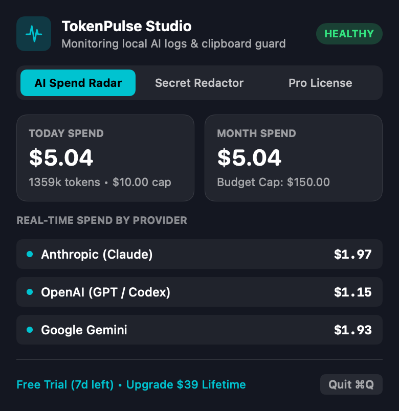
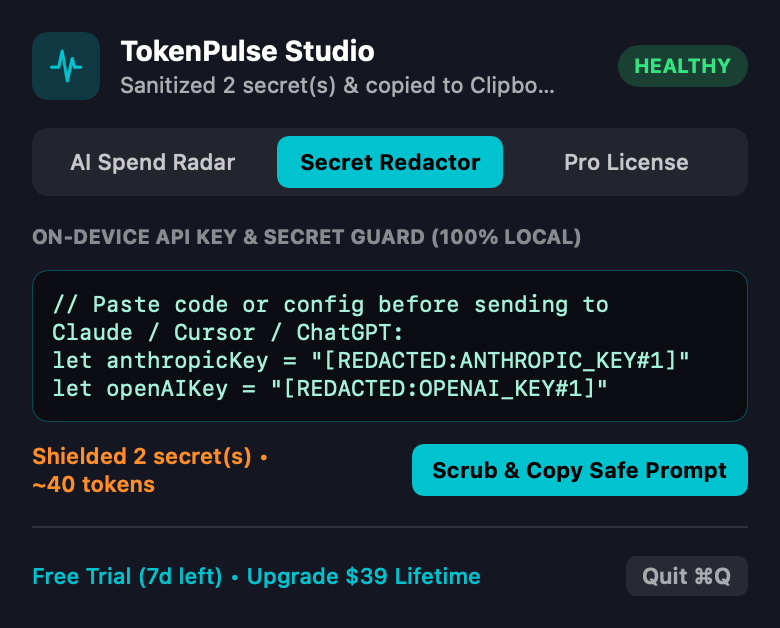

# ⚡ TokenPulse Studio for macOS

**Stop Surprise AI API Bills. Never Paste a Live Secret into an LLM Again.**

TokenPulse Studio is a native Swift 6 macOS menu bar utility (`412 KB` universal `.dmg`, signed with Apple `Developer ID Application`) that monitors local AI coding logs in real time and scrubs sensitive API keys on-device before they leave your clipboard.

- 🌐 **Live Storefront & Interactive ROI Calculator:** [https://burapa-j.github.io/TokenPulse-Studio/](https://burapa-j.github.io/TokenPulse-Studio/)
- ⬇️ **Download Latest macOS Installer (`v1.0.0`):** [TokenPulse-Studio-1.0.0.dmg](https://github.com/Burapa-J/TokenPulse-Studio/releases/download/v1.0.0/TokenPulse-Studio-1.0.0.dmg)

---

## Screenshots

| Real-Time AI Spend Radar | 100% On-Device Secret Redactor |
|---|---|
|  |  |

---

## Core Highlights

1. **Incremental Byte-Offset JSONL Log Radar (`LocalLogScanner`):**
   - Watches `~/.claude/projects`, `~/.codex`, and `~/.config/tokenpulse/logs` for `.jsonl` usage streams with zero cloud proxy middleman.
   - Exact integer micro-dollar (`$0.000001`) accounting across Anthropic (Claude 4 Opus/Sonnet/Haiku), OpenAI (GPT-4.1/o3), Google Gemini, Cursor, and Ollama.
2. **100% On-Device Secret Redactor (`SecretRedactor`):**
   - Scrubs `sk-ant-*`, `sk-proj-*`, `AIzaSy*`, `AKIA*`, `ghp_*`, `xoxb-*`, JWT Bearer tokens, and PEM private keys into safe `[REDACTED:KIND#N]` placeholders locally.
3. **Signed Native macOS App:**
   - Built with Swift 6 (`StrictConcurrency`) + SwiftUI `MenuBarExtra`. Signed with Apple `Developer ID Application` (`--options runtime --timestamp`).
